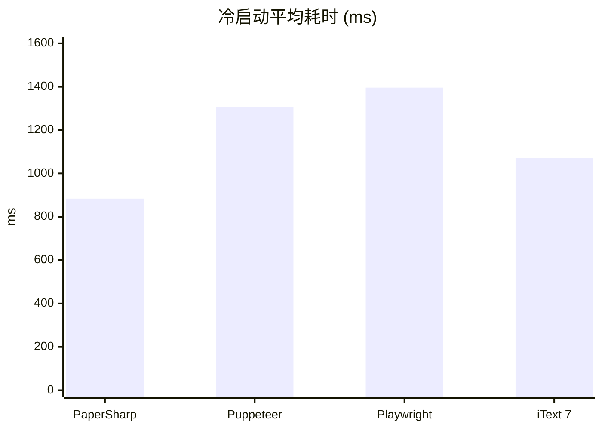
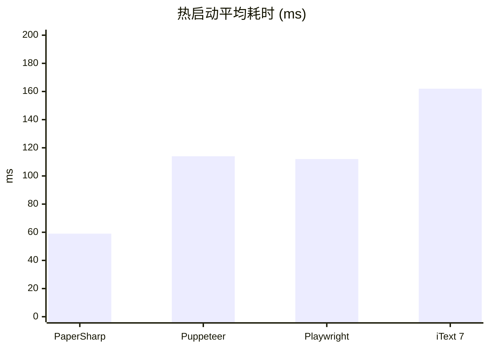
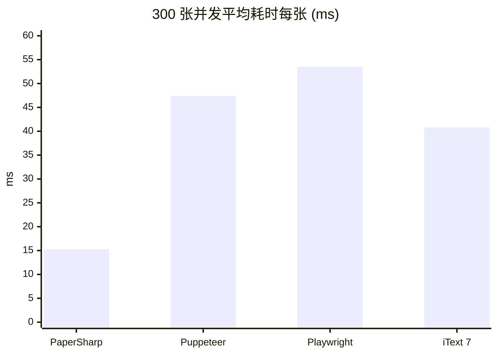
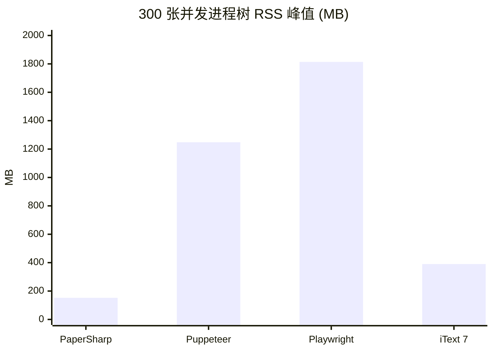

# PaperSharp

**面向 .NET 的高性能pdf/image渲染引擎** —— 纯托管代码把 HTML/CSS 直接编译为矢量 PDF 与高清图片，**无需浏览器，无需 headless Chrome，纯c#自绘**。

> `HTML + CSS` → `PDF · PNG · JPEG · WebP · ICO · SVG`

[](https://dotnet.microsoft.com)
[](#)
[](#)
[](LICENSE)
[](https://www.nuget.org/packages/PaperSharp)

## 在线演示

https://papersharp.netlify.app

## 为什么选它

- **零浏览器依赖** —— 不装 Chromium、不起子进程、不开调试端口；一个类库嵌进你的 .NET 进程即可渲染
- **服务端效率** —— 单页 PDF 中位约 30ms，单线程吞吐约 40 页/秒（PdfBench 简单语料口径；[完整四方实测与公平性说明](#性能基准可复现) 用的是更保守的中文发票语料）；**线程安全**，多请求可并发进同一进程；常驻仅一个类库的体量，没有 V8/渲染树的内存包袱
- **中文原生排版** —— CJK 逐字折行、用字级字体子集嵌入（纯文字单页 PDF 约 50–120KB，文字可选中可搜索）、中文数字页码
- **打印级语义** —— 天生面向分页媒体：`@page` 页边距、页眉页脚边距盒、自动跨页回流、表格跨页续 + `<thead>` 重复、`break-inside` / `orphans` / `widows`
- **确定性输出** —— 默认离线渲染，同一输入恒定产物，适合发票、报表、合同等财务级文档
- **需要创建html所见所得模板** 实现用户前端使用html实时编辑查看pdf模板，保存时将html保存到后端数据库，当需要生成pdf的时候，后端替换pdf中的占位符，最后将替换后的html交给`PaperSharp`生成pdf，如果pdf库不支持html，则工作量极大。

## 30 秒上手

```csharp
using PaperSharp;

byte[] pdf = Renderer.RenderPdf(html, css);                        // 分页矢量 PDF（自动注入书签、链接注释、元数据）
byte[] png = Renderer.RenderPng(html, css, width: 794, scale: 2);  // 2× 高清（~192 DPI）
```

> **字体**：包里内嵌的是 SIL OFL 授权的 Noto Sans SC 子集（regular/bold，随 dll 内嵌资源走，不依赖宿主目录）。
> CSS 里写 `"Microsoft YaHei"` 而本机装了雅黑时会自动用系统字面；想让引擎吃自己烤的子集
> （体积与跨平台一致都要靠它），在首次渲染前设 `FontManager.BundledFontDirectory`。
>
> Linux 需安装 `fonts-noto-cjk` 才有中文回退；`monospace` 回退是纯拉丁系，中文等宽要显式配 CJK 字体。

## 示例集锦

> 每个场景一行调用 / 一段 CSS 搞定；文末给出仓内对应的完整验收样例。

**① 一行代码出 PDF**

```csharp
byte[] pdf = Renderer.RenderPdf(
    "<h1>发票</h1><p>合计：¥1,234.00</p>",
    "h1 { color: #2c3e50 }  p { font-size: 14px }");
```

**② 打印文档：页边距 + 页眉页脚页码，全自动**

```css
@page {
  size: A4;  margin: 25mm 20mm;
  @top-center    { content: "季度财务报表"; font-size: 9pt; color: #888 }
  @bottom-center { content: "第 " counter(page) " 页 / 共 " counter(pages) " 页" }
}
```

内容超一页自动回流，边距盒每页重绘。→ 完整样例 `assets/report.html`

**③ 400 行长表：跨页续 + 每页重复表头 + 中文页码**

```css
table { border-collapse: collapse; width: 100% }
thead { display: table-header-group }   /* 每页自动重放表头 */
tr    { break-inside: avoid }           /* 单行不跨页折断 */
td    { padding: 6px 10px }             /* 支持 % 列宽、<col>、colspan/rowspan */
@page { @bottom-right { content: counter(page, cjk-ideographic) " / " counter(pages) " 页" } }
```

跨页列宽共享、`rowspan` 续格自动补边框。→ `assets/m1.html`（400 行明细发票）

**④ 图卡输出：一个模板，五种格式**

```csharp
using SkiaSharp;

byte[] png = Renderer.RenderPng(html, css, width: 1200, scale: 2);   // OG 图（1600px 宽 2× 高清）
byte[] jpg = Renderer.RenderImage(html, css, 1200, SKEncodedImageFormat.Jpeg, quality: 82);
byte[] svg = Renderer.RenderSvg(html, css, 1200);                    // 矢量：渐变/裁剪映射为 SVG 原生
byte[] ico = Renderer.RenderIco(html, css, size: 64, width: 512);    // favicon，多尺寸
```

**⑤ 视觉全开：conic 渐变 + squircle + 遮罩 + 滤镜，纯 CSS**

```css
.hero {
  border-radius: 32px;  corner-shape: squircle;
  background: conic-gradient(from 45deg, #f6d365, #fd6589, #84fab0, #f6d365);
  box-shadow: 0 12px 40px rgba(0, 0, 0, .25);
  mask-image: linear-gradient(to bottom, black 60%, transparent);
  filter: blur(0px) drop-shadow(0 4px 12px rgba(255, 0, 128, .4));
  mix-blend-mode: screen;
}
```

→ `assets/m3.html`（OG 图卡风整页）

**⑥ 中文图文混排：真 inline 行盒**

```html
<p>本月营收 <strong class="up">↑ 128%</strong>（含税口径），
   扫码或点击 <a href="https://example.com/report">完整报表</a>
    查看明细。</p>
```

混排按行盒折行、基线对齐、CJK 逐字断行；渲进 PDF 后 `<a>` 变成**可点击的链接注释**，精确到行内片段矩形。→ `assets/inline.html`

**⑦ 书籍级 PDF：书签目录自动生成**

```csharp
byte[] pdf = Renderer.RenderPdf(bookHtml, css);
// h1–h6 → PDF 阅读器侧边栏书签层级；<title>/<meta name=author|description> → 文档元数据
```

零配置，Skia 不提供此 API——书签/注释由自研 `PdfEnhancer` 增量尾部注入。→ `assets/m5.html`

**⑧ 字体与主题：一行拉云端字体，var/calc 全支持**

```csharp
css = GoogleFonts.Fetch("Noto Serif SC:wght@400;700") + css;   // 联网一次，之后永久离线复用
```

```css
body  { --brand: #1a73e8; --gap: 12px }
.btn  { background: var(--brand, #333); padding: calc(var(--gap) / 2) calc(var(--gap) * 2) }
.col  { width: calc(100% / 3 - var(--gap)) }
```

→ `assets/m4.html`（var/calc 全谱 + 多字体）

**⑨ 多文种混排：阿拉伯连写 + RTL 双向 + emoji**

```css
.letter { direction: rtl; text-align: start }   /* RTL 段落：折行、对齐、行内盒序全部镜像 */
```

阿拉伯文经 HarfBuzz 连写成形；RTL 段里的拉丁词/数字按 bidi run 排布；emoji（含 ZWJ 家庭序列）与缺字按字形级回退，不再出豆腐块。→ `assets/m7.html`（阿拉伯/希伯来/越南/韩中混排整页）

## 能力速览（每项都有验收样例，位于 `src/PaperSharpSamples/assets/`）

- **分页**：块级跨页回流；长表跨页续 + 共享列宽 + 重复 `<thead>`；`break-before/after: page`、`break-inside: avoid`、`orphans/widows`；`@page` size/margin + 页眉页脚边距盒 + `counter(page/pages)`（含中文数字页码）
- **布局**：flexbox 全家（含 wrap/reverse/gap/嵌套）、Grid 子集、float + 图文环绕、relative/absolute + z-index 盖顶、`%` 单位按包含块布局期解析、`box-sizing`、min/max
- **溢出裁剪**：`overflow` / `overflow-x` / `overflow-y` 的 `hidden`·`clip`·`auto`·`scroll`·`overlay` 一律裁剪到 padding box（定格输出没有滚动位置，也不画滚动条）；一轴非 `visible` 即两轴同裁（规范折算）；祖先带 `border-radius` 时按圆角矩形裁；脱流（`position:absolute`）子盒同样按树祖先链裁剪，不逃逸
- **选择器与伪元素**：`:is()`/`:where()`（AngleSharp 原生）、`::before`/`::after` 生成内容（字符串 / `attr()` / `open-quote`·`close-quote` / `url()` 图 / `counter()`·`counters()` 自动编号，含中文数字），块级与行内成盒
- **文本**：inline 混排真行盒（span/a/br/inline-block/行内 img，基线对齐 + `vertical-align`）、CJK 逐字 / Latin 逐词折行、`white-space`/`word-break`/`text-overflow: ellipsis`/`letter-spacing`/`text-transform`/`text-decoration`、`text-wrap: balance`、`text-fit`
- **视觉**：圆角（含 squircle）/阴影/linear·radial·conic 渐变/opacity/`mix-blend-mode`/`clip-path`/`mask-image`/`filter: blur|drop-shadow` 链/`background-clip: text`（渐变文字）/`backdrop-filter`（毛玻璃，仅位图路径）/内联 `<svg>`
- **字体**：构建期 fonttools 子集化 + 随 dll 内嵌（纯文字单页 PDF 从 ~2.5MB 降到 50–120KB）、`@font-face`（多 src 回退/woff2）、`GoogleFonts.Fetch()` 下载+缓存+离线复用、`RegisterFontDirectory`、`BundledFontDirectory`（宿主自带子集）、跨平台系统回退
- **复杂文字**：HarfBuzz shaping（阿拉伯连写）、`direction: rtl` + 轻量 bidi 混排、扩展字素安全折行（emoji ZWJ/组合符不拆散）、字形级字体回退（emoji/小语种不再出豆腐块）
- **动画（确定性取帧）**：解析 `@keyframes` + `animation` 全套（timing/iteration/direction/fill），渲染传 `animationTime`（秒）即取该时刻的一帧，对 opacity/颜色/长度/圆角/字号/定位偏移按帧插值；输出仍是静态单帧、逐字节确定。Tailwind `animate-pulse` 已映射（详见边界）
- **输出**：矢量 PDF（h1–h6 书签 + `<a>` 链接注释 + metadata，经自研 `PdfEnhancer` 增量尾部注入）/ PNG（scale 高清）/ JPEG / WebP / ICO / SVG
- **边界**：`@media`/`transform`/`fixed`/`sticky`/网络图不支持；`overflow` 有裁剪但**不建立 BFC**（`overflow:hidden` 不隔离浮动与父子 margin 坍缩，`display:flow-root` 同）；`transform` 未实现 → 依赖它的动画（`spin`/`ping`/`bounce`）关键帧会被解析但不生效，仅 opacity/颜色/长度类动画可取帧；`backdrop-filter` 只在位图（PNG/JPEG/WebP）路径生效，PDF/SVG 矢量路径跳过；嵌套双向、国旗 emoji、shaped run 的 letter-spacing 是复杂文字的已知简化

## 性能基准（可复现）

四方实测 **PaperSharp / PuppeteerSharp / Microsoft.Playwright / iText 7 pdfHTML**，数字取自可核查的
[`v1.0.3.json`](benchmarks/CiBench/results/v1.0.3.json) / [`.csv`](benchmarks/CiBench/results/v1.0.3.csv)，
不是挑出来的最好一次；工具与全部口径见 [CiBench README](benchmarks/CiBench/README.md)。
快照采集于 **2026-11-08 22:42 (UTC+8)**，对应 v1.0.3 的 `src/PaperSharp`（测量时 `df9dbb7` → v1.0.3 之间 `src/` 无改动）。

**环境** · Windows 10.0.26300 x64 · `Intel64 Family 6 Model 167` / 16 逻辑核 · .NET 10.0.10 · Chrome 156.0.8078.81（两家 Chromium 共用）· 语料 `spec/invoice.html` 4,804B / SHA-256 `0F51278375B7182F` · 冷·热各 20 次取算术平均 · 并发 100/200/300 张 · 固定 4 worker · Release · `--strict` 四家全 `ok`
**版本** · PaperSharp v1.0.3 · PuppeteerSharp 25.8.0 · Microsoft.Playwright 1.64.1 · iText 7 pdfHTML 6.3.4（Core 9.8.0；AGPLv3/商业双授权，仅作被测依赖，不随 NuGet 包分发）

| 引擎（300 张并发档） | 内核 | 冷启动 ms | 热启动 ms | 冷/热 | 平均/张 ms | 吞吐 docs/s | P95 ms | RSS 峰值 MB | 产物 KB |
|---|---|---:|---:|---:|---:|---:|---:|---:|---:|
| **PaperSharp** | 纯托管自绘（无浏览器） | **884.3** | **58.7** | 15.1× | **15.3** | **65.29** | **64.4** | **152.1** | 170.8 |
| PuppeteerSharp 25.8.0 | Chromium / Blink（CDP） | 1308.3 | 114.4 | 11.4× | 47.4 | 21.12 | 208.8 | 1248.4 | 140.3 |
| Microsoft.Playwright 1.64.1 | Chromium / Blink（driver） | 1396.1 | 112.4 | 12.4× | 53.5 | 18.68 | 233.9 | 1814.0 | 108.9 |
| iText 7 pdfHTML 6.3.4 | 解析型布局（无浏览器） | 1069.9 | 161.6 | 6.6× | 40.8 | 24.54 | 204.8 | 389.8 | 191.0 |

三档均 100/100、200/200、300/300 全部成功，无跳过、无补零；完整三档明细见 [CSV](benchmarks/CiBench/results/v1.0.3.csv)
与 [CiBench README 快照](benchmarks/CiBench/README.md)。

**8 张图速览** · 每行 4 张、点击可放大；y 轴均从 0 起，冷/热量级差约 10 倍故各自独立定标。柱色固定：蓝 = PaperSharp，橙 = PuppeteerSharp，绿 = Playwright，紫 = iText 7。图由 [make_readme_charts.py](benchmarks/CiBench/tools/make_readme_charts.py) 从 `v1.0.3.json` 生成，深浅色主题自适应；不支持 SVG 的阅读器看上表，或展开下方 Mermaid 大图。

<p align="center">
<a href="benchmarks/CiBench/results/charts/01-cold-start.svg?raw=true"></a>
<a href="benchmarks/CiBench/results/charts/02-warm-start.svg?raw=true"></a>
<a href="benchmarks/CiBench/results/charts/03-avg-per-doc.svg?raw=true"></a>
<a href="benchmarks/CiBench/results/charts/04-latency-p95.svg?raw=true"></a>
</p>

<p align="center">
<a href="benchmarks/CiBench/results/charts/05-throughput.svg?raw=true"></a>
<a href="benchmarks/CiBench/results/charts/06-rss-peak.svg?raw=true"></a>
<a href="benchmarks/CiBench/results/charts/07-managed-alloc.svg?raw=true"></a>
<a href="benchmarks/CiBench/results/charts/08-pdf-size.svg?raw=true"></a>
</p>

<details>
<summary><b>展开：4 张 Mermaid 大图（主题自适应）· 公平性口径 · 边界与复现命令</b></summary>

**单张导出平均耗时**（20 次取平均，ms，越低越好；冷/热量级差约 10 倍，分开独立定标）：





**并发 300 张 · 平均耗时/张 (ms)** 与 **进程树 RSS 峰值 (MB)**：





RSS 含 Chrome / Playwright driver 的全部子进程，是浏览器方案真实的内存成本，不是只算 .NET 托管堆。
x 轴缩写：`Puppeteer` = PuppeteerSharp，`Playwright` = Microsoft.Playwright，`iText 7` = iText 7 pdfHTML。

**公平性**：① 四家从同一 HTML 字符串重新排版（无缓存红利）+ 统一 A4 / 0 margin / `printBackground`；
② 产出 `byte[]` 后统一落盘，父进程墙钟计时（含写盘、不含删临时文件）；③ 20 次取算术平均、不剔慢值，
p50/p95/σ/max 全在 JSON（PaperSharp 冷启动 884.3 / p50 888.5 / p95 953.1 / σ 53.4）；
④ 冷启动每次全新子进程、热态每引擎独立子进程，互不污染内存；⑤ 固定 4 worker 消费队列，两家 Chromium
各共享一个 browser、每 worker 独占一个 page，是真实服务端形态而非理论最优调参；⑥ RSS = 本进程 + 全部后代
进程工作集采样峰值（25ms 一轮，3 点中位抑制 PID 复用假尖峰）；⑦ 全用默认 API，未单独调优；⑧ 不对等处如实列出。

**口径边界**：渲染内核不等价（Blink / 自绘 / 解析型），比的是「同一语料出一张 PDF 的成本」，
不是同一排版结果的实现快慢；iText CSS 支持面窄（无 flex/grid），耗时与产物体积不代表还原度
（看 `benchmarks/PdfBench/fidelity`）；iText 中文已显式绑 CJK 字体（TTC 按 `路径,索引`），
产物 191KB 嵌入 MicrosoftYaHei 子集才计入对比，否则会静默丢字只剩约 3KB；Playwright RSS 含 driver 而
PuppeteerSharp 不含，约 45% 差距主要来自进程模型；首页「30ms / 40 页每秒」是 PdfBench 简单语料口径，
与本表（中文发票 + 新进程 + 含落盘）不可换算；单机单次测量，CI 的 Linux runner 尚未实跑 Playwright
driver 依赖，跨机器请用 `--baseline` 看相对变化。

**复现**（需 .NET 10 SDK / Chrome；Linux 另装 `fonts-noto-cjk`；Windows 用 `.\benchmarks\CiBench\run.ps1`）：

```bash
git clone https://github.com/SpringHgui/papersharp.git && cd papersharp
bash benchmarks/CiBench/run.sh --concurrency 4 --strict
```

跑完看 `benchmarks/CiBench/out/report.html`（8 张 SVG 图 + 全指标表）与 `results.json` / `csv` / `summary.md`；
CI 由 [`.github/workflows/pdf-ci-bench.yml`](.github/workflows/pdf-ci-bench.yml) 自动执行（PR 冒烟、每周全量、artifact + job summary）。

</details>
