# PaperSharp

**面向 .NET 的高性能pdf/image渲染引擎** —— 纯托管代码把 HTML/CSS 直接编译为矢量 PDF 与高清图片，**无需浏览器，无需 headless Chrome，纯c#自绘**。

> `HTML + CSS` → `PDF · PNG · JPEG · WebP · ICO · SVG`

[](https://dotnet.microsoft.com)
[](#)
[](#)
[](LICENSE)
[](https://www.nuget.org/packages/PaperSharp)

## 在线演示

https://papersharp.netlify.app

## 为什么选它

- **零浏览器依赖** —— 不装 Chromium、不起子进程、不开调试端口；一个类库嵌进你的 .NET 进程即可渲染
- **服务端效率** —— 单页 PDF 中位约 30ms，单线程吞吐约 40 页/秒（PdfBench 简单语料口径；[完整四方实测与公平性说明](#性能基准可复现) 用的是更保守的中文发票语料）；**线程安全**，多请求可并发进同一进程；常驻仅一个类库的体量，没有 V8/渲染树的内存包袱
- **中文原生排版** —— CJK 逐字折行、用字级字体子集嵌入（纯文字单页 PDF 约 50–120KB，文字可选中可搜索）、中文数字页码
- **打印级语义** —— 天生面向分页媒体：`@page` 页边距、页眉页脚边距盒、自动跨页回流、表格跨页续 + `<thead>` 重复、`break-inside` / `orphans` / `widows`
- **确定性输出** —— 默认离线渲染，同一输入恒定产物，适合发票、报表、合同等财务级文档
- **需要创建html所见所得模板** 实现用户前端使用html实时编辑查看pdf模板，保存时将html保存到后端数据库，当需要生成pdf的时候，后端替换pdf中的占位符，最后将替换后的html交给`PaperSharp`生成pdf，如果pdf库不支持html，则工作量极大。

## 30 秒上手

```csharp
using PaperSharp;

byte[] pdf = Renderer.RenderPdf(html, css);                        // 分页矢量 PDF（自动注入书签、链接注释、元数据）
byte[] png = Renderer.RenderPng(html, css, width: 794, scale: 2);  // 2× 高清（~192 DPI）
```

> **字体**：包里内嵌的是 SIL OFL 授权的 Noto Sans SC 子集（regular/bold，随 dll 内嵌资源走，不依赖宿主目录）。
> CSS 里写 `"Microsoft YaHei"` 而本机装了雅黑时会自动用系统字面；想让引擎吃自己烤的子集
> （体积与跨平台一致都要靠它），在首次渲染前设 `FontManager.BundledFontDirectory`。
>
> Linux 需安装 `fonts-noto-cjk` 才有中文回退；`monospace` 回退是纯拉丁系，中文等宽要显式配 CJK 字体。

## 性能基准（可复现）

五方实测 **PaperSharp / PuppeteerSharp / Microsoft.Playwright / iText 7 pdfHTML / IronPdf**，数字取自可核查的
[`v1.0.4.json`](benchmarks/CiBench/results/v1.0.4.json) / [`.csv`](benchmarks/CiBench/results/v1.0.4.csv)，
不是挑出来的最好一次；工具与全部口径见 [CiBench README](benchmarks/CiBench/README.md)。
快照采集于 **2026-11-09 00:05 (UTC+8)**，对应 commit `88f3832`（`src/` 较上一快照无改动，仅基准新增 IronPdf 一家）。

**环境** · Windows 10.0.26300 x64 · `Intel64 Family 6 Model 167` / 16 逻辑核 · .NET 10.0.10 · Chrome 156.0.8078.81（Puppeteer/Playwright 共用；IronPdf 用自带 Chromium 构建，同等内核）· 语料 `spec/invoice.html` 4,804B / SHA-256 `0F51278375B7182F` · 冷·热各 20 次取算术平均 · 并发 100/200/300 张 · 固定 4 worker · Release · `--strict` 五家全 `ok`
**版本** · PaperSharp v1.0.3 · PuppeteerSharp 25.8.0 · Microsoft.Playwright 1.64.1 · iText 7 pdfHTML 6.3.4（Core 9.8.0；AGPLv3/商业双授权，仅作被测依赖，不随 NuGet 包分发）· **IronPdf 2026.11.0.1（trial license，2026-12-08 到期，输出 PDF 含水印）**

| 引擎（300 张并发档） | 内核 | 冷启动 ms | 热启动 ms | 冷/热 | 平均/张 ms | 吞吐 docs/s | P95 ms | RSS 峰值 MB | 产物 KB |
|---|---|---:|---:|---:|---:|---:|---:|---:|---:|
| **PaperSharp** | 纯托管自绘（无浏览器） | **1045.9** | **73.0** | 14.3× | **15.6** | **64.05** | **61.6** | **148.2** | 170.8 |
| PuppeteerSharp 25.8.0 | Chromium / Blink（CDP） | 1190.0 | 120.2 | 9.9× | 51.7 | 19.35 | 222.5 | 1319.4 | 140.3 |
| Microsoft.Playwright 1.64.1 | Chromium / Blink（driver） | 1358.6 | 117.5 | 11.6× | 51.3 | 19.50 | 207.0 | 1822.6 | 108.9 |
| iText 7 pdfHTML 6.3.4 | 解析型布局（无浏览器） | 1367.0 | 171.3 | 8.0× | 46.2 | 21.67 | 233.6 | 367.2 | 191.0 |
| IronPdf 2026.11.0.1（trial） | Chromium / Blink（自带构建） | 6353.2 | 244.9 | 25.9× | 58.8 | 16.99 | 254.4 | 2536.6 | 110.3 |

三档均 100/100、200/200、300/300 全部成功，无跳过、无补零；完整三档明细见 [CSV](benchmarks/CiBench/results/v1.0.4.csv)
与 [CiBench README 快照](benchmarks/CiBench/README.md)。

**8 张图速览** · 每行 2 张、宽度撑满表格单元格、点击可放大；y 轴均从 0 起，冷/热量级差约 10 倍故各自独立定标。柱色固定：蓝 = PaperSharp，橙 = PuppeteerSharp，绿 = Playwright，紫 = iText 7，红 = IronPdf。图由 [make_readme_charts.py](benchmarks/CiBench/tools/make_readme_charts.py) 从 `v1.0.4.json` 生成（240×160，深浅色主题自适应，内联颜色兜底）；不支持 SVG 的阅读器看上表，或展开下方 Mermaid 大图。

<table>
<tr>
<td align="center"><a href="benchmarks/CiBench/results/charts/01-cold-start.svg?raw=true">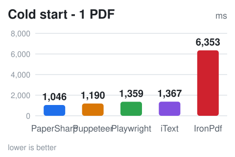</a></td>
<td align="center"><a href="benchmarks/CiBench/results/charts/02-warm-start.svg?raw=true">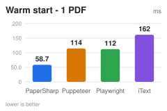</a></td>
</tr>
<tr>
<td align="center"><a href="benchmarks/CiBench/results/charts/03-avg-per-doc.svg?raw=true">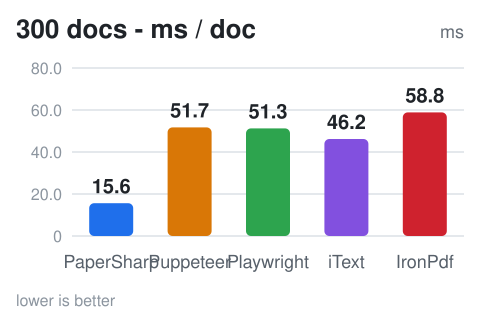</a></td>
<td align="center"><a href="benchmarks/CiBench/results/charts/04-latency-p95.svg?raw=true">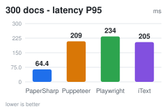</a></td>
</tr>
<tr>
<td align="center"><a href="benchmarks/CiBench/results/charts/05-throughput.svg?raw=true">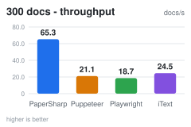</a></td>
<td align="center"><a href="benchmarks/CiBench/results/charts/06-rss-peak.svg?raw=true">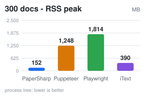</a></td>
</tr>
<tr>
<td align="center"><a href="benchmarks/CiBench/results/charts/07-managed-alloc.svg?raw=true">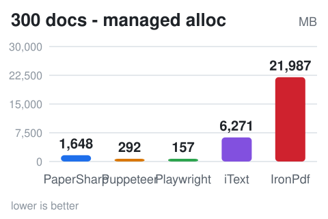</a></td>
<td align="center"><a href="benchmarks/CiBench/results/charts/08-pdf-size.svg?raw=true">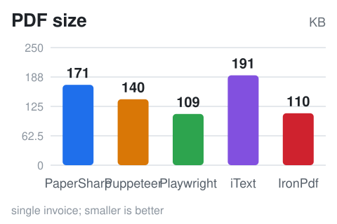</a></td>
</tr>
</table>

<details>
<summary><b>展开：5 张 Mermaid 大图（主题自适应）· 公平性口径 · 边界与复现命令</b></summary>

**单张导出平均耗时**（20 次取平均，ms，越低越好；冷/热量级差约 10 倍，分开独立定标）：

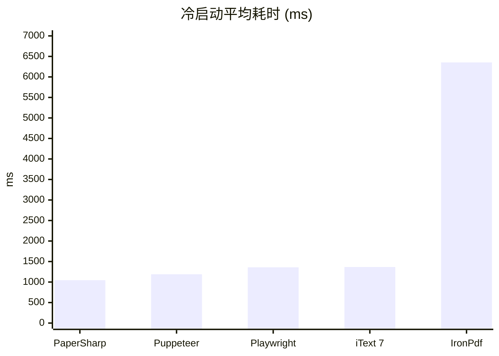

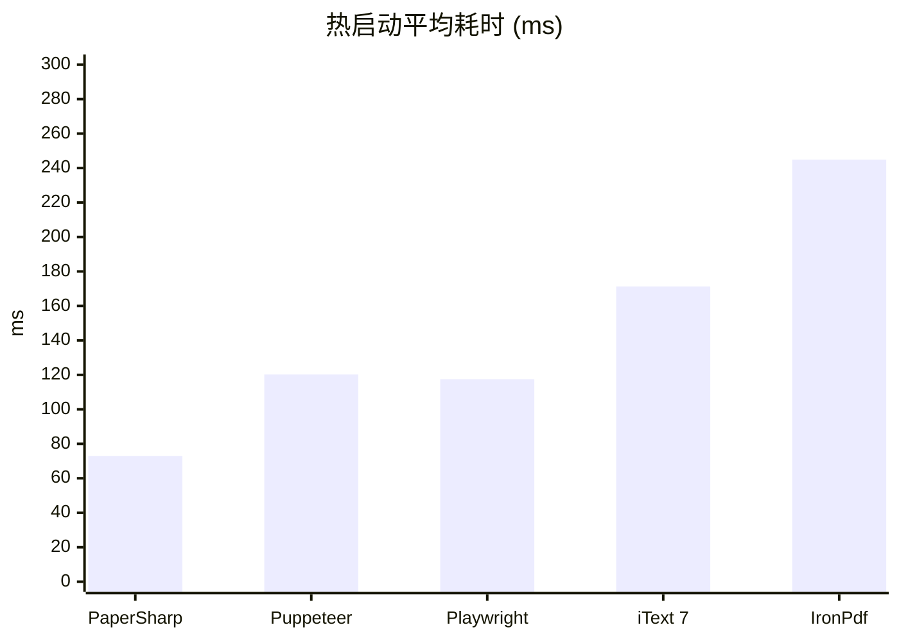

**并发 300 张 · 平均耗时/张 (ms)** 与 **进程树 RSS 峰值 (MB)**：

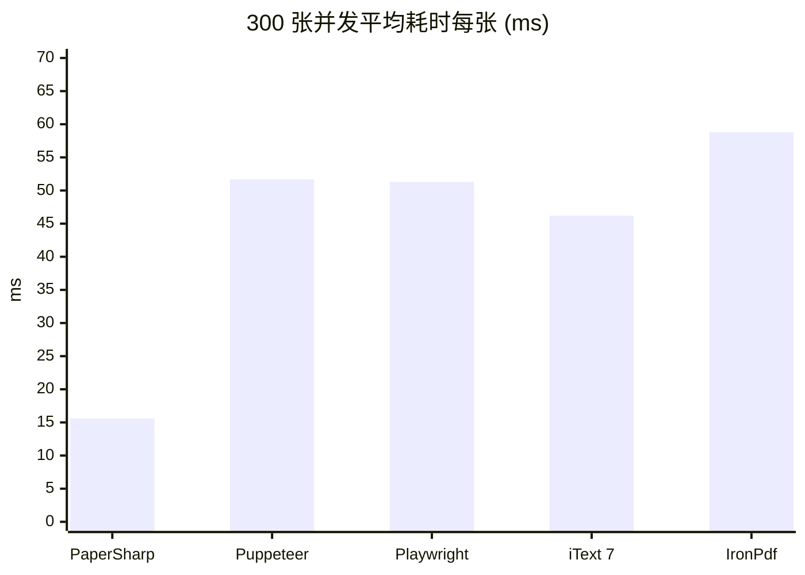

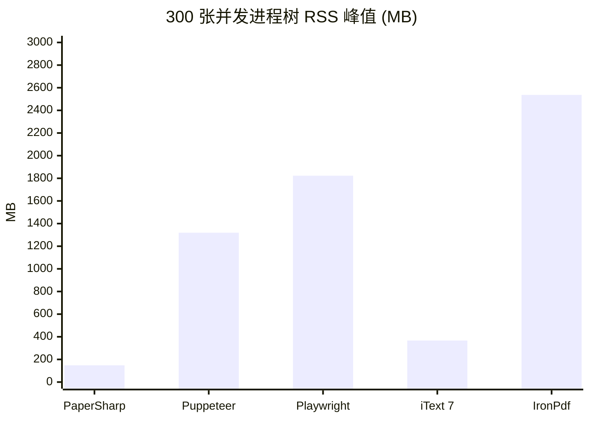

RSS 含 Chrome / Playwright driver 的全部子进程，是浏览器方案真实的内存成本，不是只算 .NET 托管堆。
x 轴缩写：`Puppeteer` = PuppeteerSharp，`Playwright` = Microsoft.Playwright，`iText 7` = iText 7 pdfHTML。

**公平性**：① 五家从同一 HTML 字符串重新排版（无缓存红利）+ 统一 A4 / 0 margin / `printBackground`；
② 产出 `byte[]` 后统一落盘，父进程墙钟计时（含写盘、不含删临时文件）；③ 20 次取算术平均、不剔慢值，
p50/p95/σ/max 全在 JSON（PaperSharp 冷启动 1045.9 / p50 1075.2 / p95 1248.2 / σ 125.3）；
④ 冷启动每次全新子进程、热态每引擎独立子进程，互不污染内存；⑤ 固定 4 worker 消费队列，Chromium 系引擎
各共享一个 browser（Puppeteer/Playwright 共用系统 Chrome，IronPdf 用自带 Chromium 构建）、每 worker 独占一个 page，是真实服务端形态而非理论最优调参；⑥ RSS = 本进程 + 全部后代
进程工作集采样峰值（25ms 一轮，3 点中位抑制 PID 复用假尖峰）；⑦ 全用默认 API，未单独调优；⑧ 不对等处如实列出。

**口径边界**：渲染内核不等价（Blink / 自绘 / 解析型），比的是「同一语料出一张 PDF 的成本」，
不是同一排版结果的实现快慢；iText CSS 支持面窄（无 flex/grid），耗时与产物体积不代表还原度
（看 `benchmarks/PdfBench/fidelity`）；iText 中文已显式绑 CJK 字体（TTC 按 `路径,索引`），
产物 191KB 嵌入 MicrosoftYaHei 子集才计入对比，否则会静默丢字只剩约 3KB；Playwright RSS 含 driver 而
PuppeteerSharp 不含，约 45% 差距主要来自进程模型；首页「30ms / 40 页每秒」是 PdfBench 简单语料口径，
与本表（中文发票 + 新进程 + 含落盘）不可换算；IronPdf 用 trial license，输出 PDF 含水印、且冷启动最慢（6.3s / 冷热比 25.9×）、300 档 RSS 峰值最高（2.5GB），仅作商业闭源方案参照；单机单次测量，CI 的 Linux runner 尚未实跑 Playwright
driver 依赖，跨机器请用 `--baseline` 看相对变化。

**复现**（需 .NET 10 SDK / Chrome；Linux 另装 `fonts-noto-cjk`；Windows 用 `.\benchmarks\CiBench\run.ps1`）：

```bash
git clone https://github.com/SpringHgui/papersharp.git && cd papersharp
bash benchmarks/CiBench/run.sh --concurrency 4 --strict
```

跑完看 `benchmarks/CiBench/out/report.html`（8 张 SVG 图 + 全指标表）与 `results.json` / `csv` / `summary.md`；
CI 由 [`.github/workflows/pdf-ci-bench.yml`](.github/workflows/pdf-ci-bench.yml) 自动执行（PR 冒烟、每周全量、artifact + job summary）。

</details>
